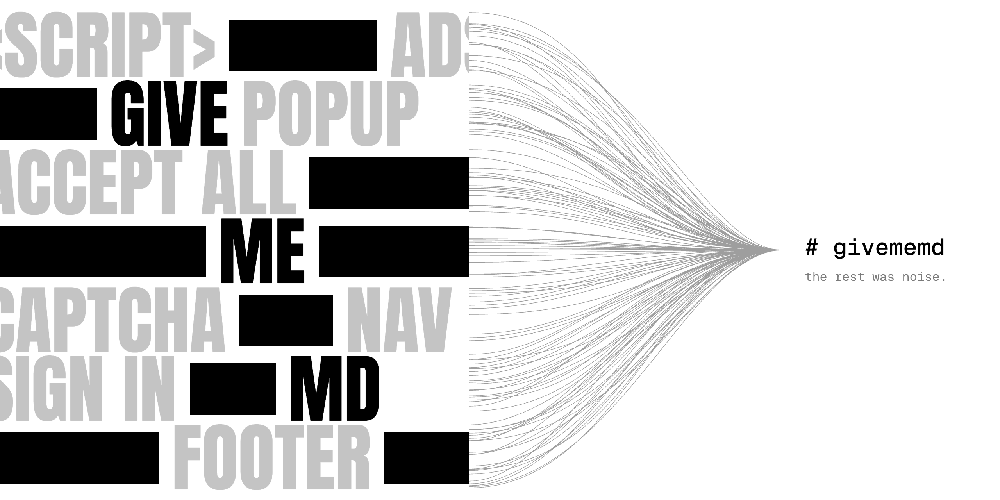

<p align="center"></p>

# givememd

Turn any web page into clean, token-lean markdown for LLMs.

```sh
givememd https://www.zillow.com/homes/Austin,-TX_rb/
```

givememd fetches the page (escalating from a plain request to a headless browser only when needed), works out
what is content and what is chrome, and returns markdown that keeps the facts and drops the noise: listings hidden in
a page's app state become tables, menus and cookie banners disappear, and walled pages are reported as walled instead of
being passed off as content.

## Requirements

givememd ships for both **Python 3.10+** and **Node 20+**; pick one. Both run on macOS (Intel and Apple silicon),
Linux (x86-64 and ARM, glibc and musl) and Windows (x64 and ARM). No compiler, API key or account is needed.

```sh
pip install givememd        # or: npm i givememd   (or no install: npx givememd <url>)
```
Or straight from a clone of this repository, with the normal install for either language:
```sh
git clone https://github.com/ishanray/givememd && cd givememd
pip install .               # Python, then: givememd <url>
npm install                 # Node (installs and builds js/), then: npx givememd <url>
```

**JavaScript-heavy pages work out of the box.** Most pages are read with one plain request: 86% of the top sites we
could read, and 92% of smaller sites. Apps like Reddit, Amazon's homepage or character.ai need a real browser, and
givememd uses one automatically:
1. **An installed browser:** Chrome, Edge, Brave or Chromium, driven headlessly. Nothing to download.
2. **Otherwise, a one-time download:** on the first page that needs JavaScript, givememd fetches Playwright's
   headless Chromium (about 100 MB download, 200 MB on disk) and reuses it afterwards.
   `GIVEMEMD_CHROME=/path/to/chrome` picks a browser; `GIVEMEMD_NO_BROWSER_DOWNLOAD=1` disables the download.
3. **Optional, faster:** [Lightpanda](https://github.com/lightpanda-io/browser) (AGPL, not bundled), set with
   `GIVEMEMD_LIGHTPANDA=/path/to/lightpanda`.

Using it from Claude or other agents (MCP) needs `pip install "givememd[mcp]"` in Python; it's included in Node.

**Your connection is the fetcher.** Run locally (CLI, library or MCP server), every request comes from your machine and
your IP, which reads more of the web than a datacenter does. Nothing needs configuring. The optional settings are
`GIVEMEMD_ALLOWED_PORTS` (default `80,443`), `GIVEMEMD_MAX_BYTES` (default 15 MB) and, in Node,
`GIVEMEMD_STRICT_SSRF=1`. A public server needs more; see [SECURITY.md](SECURITY.md).

## Use

**CLI**
```sh
givememd https://react.dev/reference/react/useState          # markdown to stdout   (Node: npx givememd ...)
givememd amazon.com/dp/B0D1XD1ZV3 --no-links --trace          # trace shows which fetch tier was needed
```

**MCP** (runs on your machine, so pages are fetched from your own connection)
```sh
claude mcp add givememd -- npx -y givememd-mcp                         # Node
claude mcp add givememd -- uvx --from 'givememd[mcp]' givememd-mcp     # Python
```
It exposes one tool, `read_url(url, links)`.

**HTTP server** (the `givememd.com/<url>` shape, for local use)
```sh
givememd-server --port 8787
curl http://127.0.0.1:8787/en.wikipedia.org/wiki/Markdown
curl "http://127.0.0.1:8787/https://react.dev/reference/react/useState?links=0"
```
Responses carry `X-Givememd-Tier`, `X-Givememd-Source` and `X-Givememd-Partial`; the Python server also sends
`X-Givememd-Tokens`. See [SECURITY.md](SECURITY.md) before exposing anything publicly.

**Library**
```python
from givememd import read
md, result = read("https://docs.python.org/3/library/pathlib.html")
print(result.tier, md[:500])
```
```js
import { read, convert } from 'givememd';
const { markdown, result } = await read('https://docs.python.org/3/library/pathlib.html');
const md = convert(html, 'https://example.com/page', { links: false });   // HTML you already have
```

The Node package is a TypeScript port. CI requires byte-identical output to Python on shared fixtures, and on 300 real
top-site pages 97% of outputs are identical. It doesn't yet include the experimental component mode; see
[js/README.md](js/README.md).

## How it works

1. **Fetch ladder.** A plain HTTP request with a browser-like TLS fingerprint (asking for `text/markdown` first; sites
   that serve their own markdown are passed through) → Lightpanda → headless Chromium. A tier is skipped unless the previous
   one got a bot wall, an empty JavaScript shell, or a page whose content only appears after rendering.
2. **Is this real content?** Every response is classified `ok` / `blocked` / `needs_js`: vendor challenge markers
   (Cloudflare, DataDome, AWS WAF, PerimeterX…), login walls, block statuses, empty shells. When every tier hits a wall,
   givememd returns only the page's own metadata, marked `partial:`, rather than a login form.
3. **Extraction.**
   - Metadata and JSON-LD go into a compact frontmatter.
   - Record arrays embedded in the page (Next.js state, JSON-LD lists) become markdown tables. Variants (colorways, sizes)
     collapse into one row per item, and opaque IDs are dropped.
   - The DOM is pruned of chrome and hidden UI. Collapsed "see more" content, tab panels and React-streamed segments are kept.
   - Link-heavy blocks keep their headlines as one compact line and lose their menu labels.
   - The result is de-duplicated, interface text is removed, links are cleaned of tracking parameters, and listing cards
     render as single lines.
4. **Optional component mode** (`convert(..., mode='components-light')`, experimental). The page is split into small
   sections, each matched to one of 121 catalog components (product header, spec table, recipe, FAQ, navigation…). Each
   section is filled and rendered with a fixed layout, so similar pages read the same way. Labels come from rules, plus
   optionally [TypeSafe](https://typesafe.ai)'s Jev decision model (`GIVEMEMD_JEV=1` and `TYPESAFE_API_KEY`).

## How it compares

Measured on 2026-10-30 against Jina Reader (`r.jina.ai`, no key) and defuddle.md. Each tool was run on the same URLs:
a homepage plus one inner page per site, fetched from one datacenter IP. Details and caveats are in
[docs/BENCHMARK.md](docs/BENCHMARK.md).

| Set | URLs | givememd vs Jina (win / tie / loss) | givememd vs defuddle (win / tie / loss) | Median tokens: givememd vs Jina |
|---|---|---|---|---|
| Top sites (Tranco top 2,000 + AI-cited) | 3,584 | 66 / 15 / 19% | 74 / 20 / 6% | 1,034 vs 4,135 |
| Smaller sites (Tranco ranks 2k–1M) | 795 | 65 / 15 / 20% | 76 / 18 / 7% | 1,027 vs 4,525 |
| Indie blogs (Kagi Small Web) | 64–300 | 58 / 39 / 3% | 42 / 56 / 2% | 1,059 vs 1,365 |

These scores are automatic. A page counts as "usable" if it has real content rather than a wall or an error, judged by
the same check for every tool. Facts are recall of titles, headings, paragraph sentences and JSON-LD from the raw page,
plus sentences that at least two tools agree on. Most of our remaining losses are bot walls against a datacenter IP,
and portal pages where keeping every menu scores more facts.

## Develop

```sh
pip install -e ".[dev,mcp]"
pytest                          # offline unit tests
pytest -m live                  # end-to-end: CLI, HTTP server and MCP over stdio, against the real web
python bench/fetch_pages.py     # build the local page cache (other sites' pages are never committed)
python bench/regress.py         # answer-key recall and tokens on 25 pages
python eval/run.py -v           # 19 hand-labeled pages: content lost, junk leaked, fields, component labels

npm ci                          # at the repo root; builds the Node package in js/
npm test                        # unit tests + byte-for-byte parity with the Python goldens
npm run test:live               # end-to-end: CLI, HTTP server and MCP over stdio
```
A change to extraction or detection must land in both `givememd/` and `js/src/`; `js/parity/` has the comparison tools.
The large benchmark (top, smaller and indie sites against competitors) lives in `bench/top/`; see
[docs/BENCHMARK.md](docs/BENCHMARK.md). Contributions are welcome; see [CONTRIBUTING.md](CONTRIBUTING.md).

## Roadmap

- A browser extension and a relay that lets cloud agents fetch through their owner's browser. This is how bot-walled
  and logged-in pages become readable without proxies.
- A hosted `givememd.com/<url>` with caching.
- Caching component labels per site layout, so model-assisted labeling costs almost nothing per page.

## License

MIT. Lightpanda (AGPL) and Chromium are optional and installed separately; Jev is an optional third-party API.
Product names in the benchmark belong to their owners.
